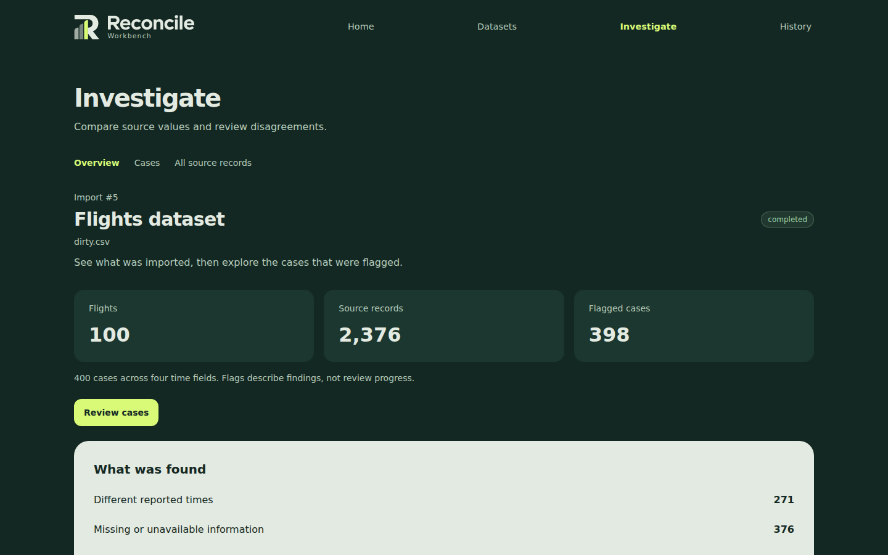
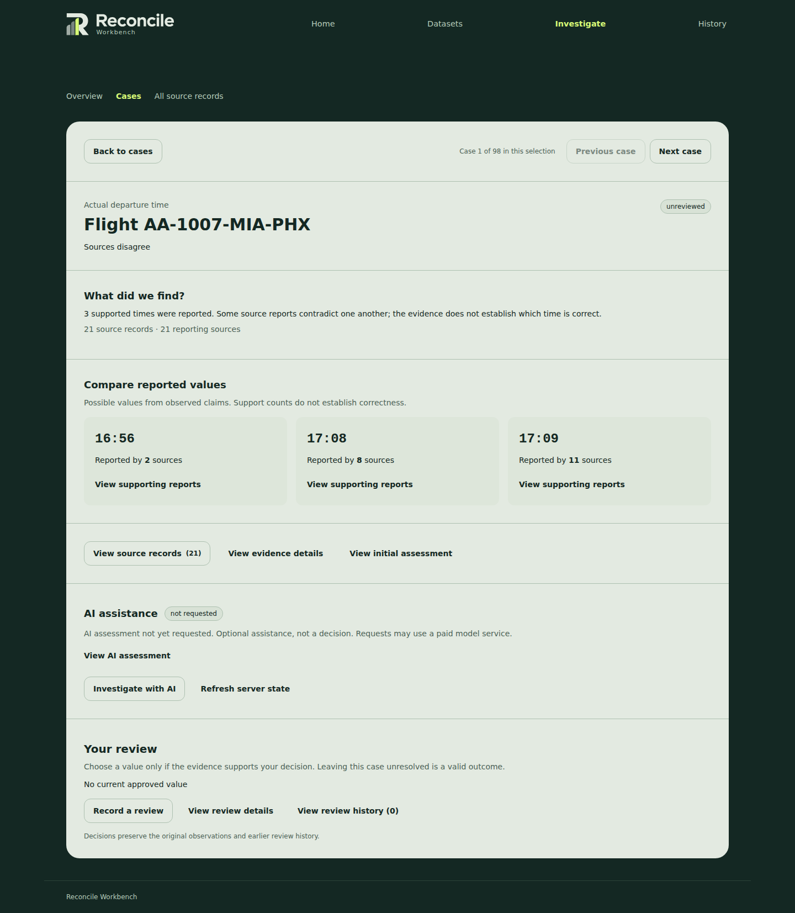
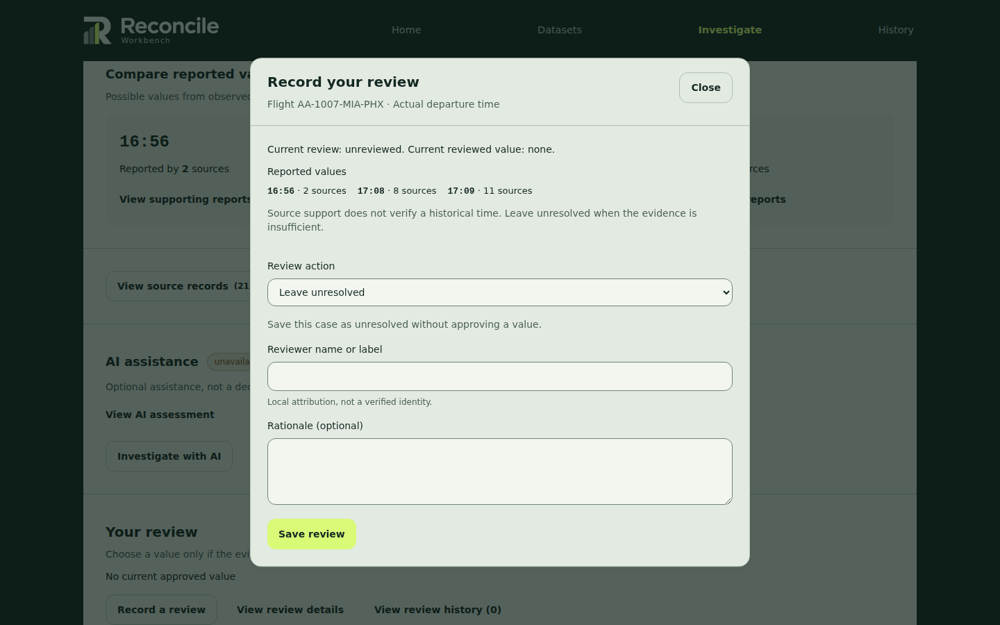
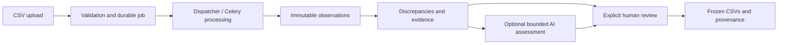

# Reconcile Workbench

**Full-Stack Data Reconciliation & Quality Platform**

Reconcile Workbench helps users import multi-source observations, find conflicting or missing
values, inspect the original evidence, record human review decisions, and produce traceable
results. Its current implementation supports the Raha Flights CSV contract.

The workflow is built around a practical distinction: **finding a disagreement is not the same
as knowing the correct value**. Several sources can agree and still be wrong. The application
preserves competing reports and uncertainty, offers optional evidence-bounded AI assistance,
and leaves the final decision with the reviewer. Leaving a case unresolved is a valid outcome.

## What you can do

- **Import observations:** validate a Flights CSV, accept a durable job and process it
  asynchronously through a dispatcher and Celery worker. Original strings and input hashes
  remain available after processing.
- **Understand the dataset:** see a real-data overview, browse paginated cases, and filter by
  finding or time field. Findings include conflicting values, missing information and uncertain
  interpretations; a flag does not imply an unreviewed case or a proven error.
- **Investigate one case:** compare source-supported values, navigate Previous/Next within the
  filtered selection, and inspect supporting, conflicting and original reports in contextual
  panels. Desktop evidence panels support wheel scrolling and pointer/keyboard resizing;
  mobile uses compact source records.
- **Record a review:** choose an observed value, enter a permitted explicit clock, accept or
  reject an eligible AI proposal, or leave the case unresolved. The review dialog preserves
  unfinished input and guards navigation. Reviewer labels are local attribution, not authenticated
  identities or proof of independent verification.
- **Keep a history:** review events are versioned and append-only through application write
  paths. Evidence digests, revisions and idempotency keys protect against stale or duplicate writes.
- **Freeze results:** create a reviewed CSV, exceptions CSV and provenance JSON tied to the
  exact evidence and decision snapshot. Later reviews do not change earlier exports. Only current
  accepted/overridden decisions populate approved values; unapproved fields remain empty.
- **Request AI explicitly:** the implemented OpenAI-compatible integration may suggest one
  existing candidate or abstain. Candidate IDs and evidence references are validated server-side;
  provider failures are distinct from abstention. AI cannot approve a correction or modify observations.
- **Evaluate offline:** file-only tooling checks frozen exports before comparing them with an
  explicitly supplied, isolated benchmark reference. It reports detection and repair outcomes,
  including harmful repairs and unresolved results.

## Screenshots

These captures show the actual local application using the published **dirty observations**,
not fictional product data or demonstrated correction accuracy. AI and review states reflect
the capture time. The review-dialog image shows an unsaved form, not a persisted decision.
Raw benchmark CSVs and clean-reference files are not included in this repository.

**Dataset overview** — import status, record counts and overlapping findings.



**Cases table** — find an individual flight/time-field case without opening all its evidence.


<details>
<summary>Focused case investigation</summary>



</details>

<details>
<summary>Source evidence panel</summary>


</details>

<details>
<summary>Human review dialog</summary>



</details>

<details>
<summary>Mobile investigation</summary>


</details>

[Product screenshot collection](docs/screenshots/product/README.md) ·
[UI interaction verification](docs/VALIDATION.md#ui-interaction-evidence)

## Architecture

A feature-oriented **modular monolith** owns the domain and API. The API, worker and dispatcher
run as separate processes from the same backend codebase; these are not independently designed
microservices. React owns interaction state and presentation. Deterministic backend code owns
normalization, discrepancies, candidate support and validation.



| Area | Implementation |
|---|---|
| Frontend | React 18, TypeScript, Vite 5, React Router 6 |
| UI | Tailwind CSS 3, owned shadcn-compatible components, Radix dialog primitives |
| API and persistence | Python, FastAPI, SQLModel / SQLAlchemy, Alembic, PostgreSQL 16 |
| Durable processing | Redis 7, Celery, database-backed job dispatch and worker fencing |
| Optional AI | OpenAI Python SDK with configured compatible Chat Completions endpoint |
| Local runtime | Docker Compose backend services; host Vite frontend |
| Tests | pytest, unittest, Vitest, Testing Library and Playwright |

Main source areas: `backend/app/intake/`, `backend/app/reconciliation/`, `backend/app/jobs/`,
`backend/app/services/` and `frontend/src/features/`. See the
[architecture guide](docs/ARCHITECTURE.md) for module ownership and operational boundaries.
The original transaction feature remains available at an unadvertised compatibility route;
its backend, migration history and existing data have not been removed.

## Run locally

Prerequisites: Docker with Compose v2 and the `default` context, Python 3.10+, Node.js 22,
and pnpm **10.32.1**. Run these commands from the repository root.

For a **new dedicated environment**:

```bash
pnpm --dir frontend install --frozen-lockfile
bash scripts/reconcile.sh init
bash scripts/reconcile.sh config
bash scripts/reconcile.sh up
bash scripts/reconcile.sh ps
```

In a second terminal:

```bash
bash scripts/reconcile.sh frontend
```

- Frontend: **http://localhost:5174/** or http://127.0.0.1:5174/
- API health: http://127.0.0.1:8011/health
- Interactive API documentation: http://127.0.0.1:8011/docs

`init` creates ignored, mode-0600 `.env.reconcile.local` with a generated local database
password. Do not commit it or print resolved Compose configuration: that contains the password.
The launcher sets the frontend API URL explicitly, and the dedicated API allows both exact
frontend origins above. No provider credential is required; the dedicated Compose configuration
leaves AI unconfigured. Provider configuration/evaluation is a separate, controlled task described
in [the AI contract](docs/AI_AND_EVALUATION.md).

The project identity is **`reconcile-workbench`**, using its own PostgreSQL, Redis and
upload/export volumes. Do not combine `compose.reconcile.yaml` with `docker-compose.yml` or use
legacy `run.sh` for this runtime. The original `file-intake-processing-service` data is separate.

**API startup applies Alembic migrations automatically** (current head: `0006`). `up` builds and
recreates the dedicated services while retaining volumes. For an already provisioned, stopped
environment, use `bash scripts/reconcile.sh start` to start its existing containers. Before any
upgrade to retained data, follow the backup/rollout guidance; database metadata and application
files must be backed up together. Preserve the local settings file with its database volumes.

Stop the dedicated backend without deleting storage:

```bash
bash scripts/reconcile.sh stop
```

Stop the host frontend with Ctrl+C. Details, volume identities and restart guidance:
[dedicated local runtime](docs/DEVELOPMENT.md). Service startup/stop commands here were not
executed during release preparation.

## Supported dataset and evaluation

The current Flights contract is **`raha_flights_v1`**, version 1, with exactly these columns:

```csv
tuple_id,src,flight,sched_dep_time,act_dep_time,sched_arr_time,act_arr_time
```

Observations are scoped to their import and opaque tuple ID. The four time fields are examined
independently; ambiguous times, placeholders and missing values remain distinguishable. No
service date, timezone or historical correctness is inferred. This is benchmark-specific flight
grouping, not production aviation identity matching or arbitrary-schema reconciliation.

The source is [BigDaMa/raha](https://github.com/BigDaMa/raha), pinned by commit and SHA-256 in
[the source manifest](docs/flights-source-manifest.json). Research attribution and dataset-rights
uncertainty are recorded in [Flights provenance](docs/AI_AND_EVALUATION.md#dataset-provenance). Upstream project
licensing does not establish clearance for all underlying dataset rights. The screenshots are
limited documentation views; they are not a license grant to redistribute the benchmark.

Keep raw benchmark files outside the repository, Docker build context and application volumes.
The operational application uses dirty observations only. **The clean reference belongs solely
to offline evaluation**, after outputs are frozen; it is not investigation evidence or model input.
No authentic benchmark repair-accuracy result is claimed. See the
[offline evaluation contract and CLI](docs/AI_AND_EVALUATION.md#frozen-output-offline-evaluation).

## Tests and validation

Install Python test dependencies in an isolated virtual environment if one is not already present:

```bash
python3 -m venv backend/.venv
backend/.venv/bin/python -m pip install -r backend/requirements.txt
```

Safe repository checks:

```bash
timeout 180s env PYTHONDONTWRITEBYTECODE=1 backend/.venv/bin/python -m pytest -p no:cacheprovider backend/tests -q
python3 -B -m unittest discover -s scripts -p 'test_flights_*.py' -q
pnpm --dir frontend test
pnpm --dir frontend build
# Set this to an existing Playwright-compatible Chromium executable:
PLAYWRIGHT_CHROMIUM_EXECUTABLE_PATH=/path/to/chromium pnpm --dir frontend test:foundation
git diff --check
```

Backend tests configure temporary SQLite/storage and memory transport before importing the
application; AI is mocked or disabled. The browser foundation harness starts a temporary Vite
server and intercepts synthetic APIs. It never proves live PostgreSQL persistence by mocking it.
Docker-backed E2E and recovery scripts have additional side effects and require separate review.

[Product-validation Milestone 1](docs/product-validation/milestone-1/REPORT.md) records an actual
isolated SQLite review/history/export workflow: persisted decisions, conflict checks, independently
read-back history, unchanged observations and byte-verified frozen artifacts. It does **not** claim
browser-level persisted writes, PostgreSQL concurrency or paid-provider validation.

Current release-check commands and results are recorded in
[the validation record](docs/VALIDATION.md); earlier results are dated separately.

## Current status and limitations

This is an actively developed portfolio project with substantial implemented functionality and
local runtime validation. It is **not a proven production deployment**.

- Flights uses one fixed input contract; dataset-wide flight search and aggregate review progress
  are not supplied by the current case-list API.
- AI integration and safeguards are implemented, but useful real-provider performance beyond the
  deterministic baseline has not been established. Failures are not model abstentions.
- Source agreement and human selection do not independently verify historical truth.
- PostgreSQL-specific concurrent claims/reviews/export races, interrupted broker/worker recovery,
  backup/restore and a browser persisted-write journey require further controlled validation.
- Reviewer attribution is an unverified local label. Authentication/RBAC and public deployment
  hardening are not implemented. Keep the local endpoints private.
- Physical-device/browser coverage is limited; software-keyboard and Safari/iOS behavior remain
  unverified. Static hosting must supply SPA fallback for direct links.

## Further documentation

[Architecture](docs/ARCHITECTURE.md) · [Development](docs/DEVELOPMENT.md) ·
[Reconciliation](docs/RECONCILIATION.md) · [AI and evaluation](docs/AI_AND_EVALUATION.md) ·
[Validation](docs/VALIDATION.md)

No root project license has been added by this checkpoint. Do not assume an open-source license
from public availability. The owned UI component sources retain their
[third-party MIT notice](frontend/src/components/ui/LICENSE); dataset notices are separate.
