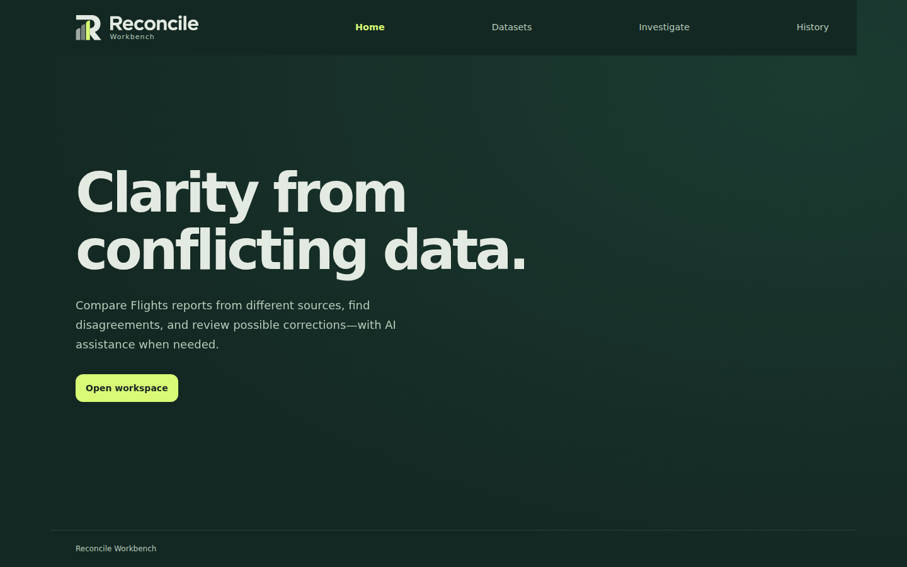
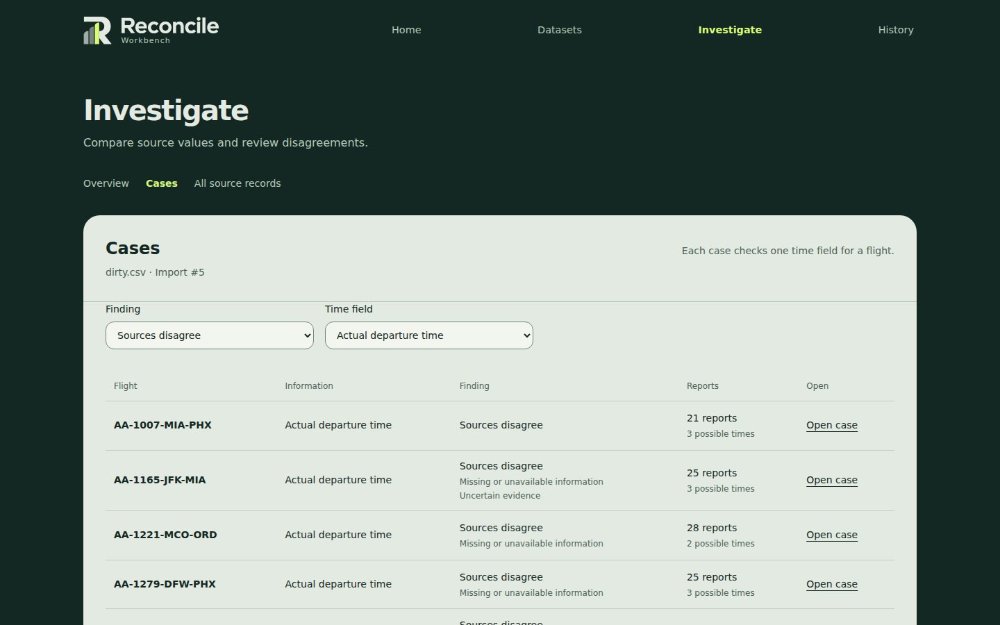
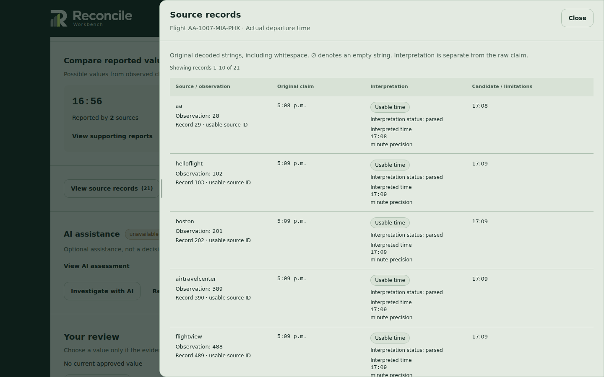
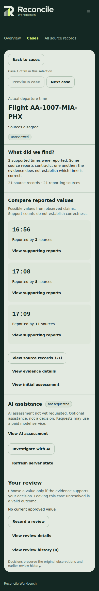
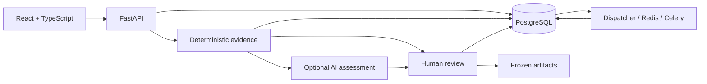

# Reconcile Workbench

I built this full-stack application to investigate disagreements between reports from different sources. You can import a Flights CSV, find conflicting or missing values, compare the original reports and record a review decision—or leave a case unresolved when the evidence is insufficient.

The React and TypeScript frontend connects to a Python/FastAPI backend and PostgreSQL. Deterministic code validates imports, interprets supported time formats and builds the evidence for each case. An optional AI assessment can suggest an existing value, but the reviewer decides what, if anything, to approve.



## Features

- **CSV imports** run asynchronously, with processing status, original input bytes and every source observation retained.
- **Dataset overviews** summarize flights, source records and overlapping findings, without presenting flagged cases as unreviewed or verified errors.
- **Case investigation** provides a filtered, paginated table and one-case-at-a-time navigation, with access to all original records.
- **Reported-value comparisons** separate source support, missing information and uncertain interpretations. More reports do not automatically make a value correct.
- **Human review** supports documented value selection, permitted manual replacements and unresolved outcomes, with versioned history and protection for unfinished drafts.
- **Frozen exports** produce a reviewed CSV, exceptions CSV and provenance JSON tied to an exact decision snapshot. Unapproved fields remain empty.
- **Optional AI assistance** offers evidence-bounded candidate suggestions or abstention through an explicit request, with validated references and no automatic approval.

## Inside the application

### Dataset Overview


### Cases Table



### Focused Investigation


### Source Evidence



The source panel preserves original claims alongside their interpretations. On desktop it supports scrolling and resizing; mobile uses compact records with expandable details.

### Human Review Dialog


The workflow screenshots use existing dirty Flights observations and document the application at capture time. The review dialog shows an unsubmitted form, not a persisted approval. AI and review states reflect those captures, not a demonstration of model accuracy.

<details>
<summary>Mobile investigation</summary>



</details>

## Architecture

The backend is a feature-oriented modular monolith. Its API, dispatcher and worker share one codebase; the frontend presents server-owned evidence and manages navigation and review drafts.



The API saves an upload and durable job intent before returning acceptance. The dispatcher and Celery worker process it independently of the browser request. Attempt tokens and leases protect result publication, while original observations remain available for investigation.

Deterministic services handle normalization, discrepancy detection, candidate support and validation. AI can interpret bounded evidence but cannot approve a repair. Explicit human decisions are appended to history; exports preserve their evidence and decision revisions even after later reviews.

| Layer | Implementation |
|---|---|
| Frontend | React 18, TypeScript, Vite 5, React Router 6, Tailwind CSS 3 and customized shadcn-compatible components |
| Backend | Python 3.10 and FastAPI; Pydantic contracts, SQLModel and SQLAlchemy |
| Storage | PostgreSQL 16, Alembic migrations and dedicated upload/export volumes |
| Processing | Redis 7, Celery and a database-backed dispatcher |
| AI | OpenAI Python SDK with a configured compatible Chat Completions endpoint |
| Quality | pytest, unittest, Vitest, Testing Library and Playwright |
| Runtime | Docker Compose backend services and a host Vite frontend |

The project evolved from a transaction-intake application. Its original backend, records and bookmarked workspace remain available for compatibility; Flights uses separate contracts and review semantics.

## Dataset and provenance

The current input contract is `raha_flights_v1`, with exactly these columns:

```csv
tuple_id,src,flight,sched_dep_time,act_dep_time,sched_arr_time,act_arr_time
```

The research sample comes from [BigDaMa/raha](https://github.com/BigDaMa/raha), pinned by commit and SHA-256 in the [source manifest](docs/flights-source-manifest.json). It contains 2,376 observations across 100 flight identifiers. Original strings are retained; ambiguous clocks, unavailable values and unsupported context remain distinguishable rather than being silently corrected.

Dirty observations are operational evidence. The clean benchmark reference is withheld from investigation and AI, and is used only by separate offline tooling after results are frozen. Source agreement and reference consistency do not independently verify historical flight times.

Benchmark source files stay outside Git and are not mounted into application containers. Underlying dataset redistribution rights remain unresolved despite the upstream project's license notice. See [research provenance, use restrictions and evaluation methodology](docs/AI_AND_EVALUATION.md#dataset-provenance); existing screenshots are limited documentation views, not dataset redistribution clearance.

## Run locally with Docker

Requires Docker Engine/Desktop with Compose v2 and context `default`, Python 3 for local settings, Node.js 22 and pnpm 10.32.1 for the host frontend. For a new checkout:

```bash
git clone https://github.com/iayushmahajan/File-Intake-Data-Quality-Platform.git
cd File-Intake-Data-Quality-Platform
pnpm --dir frontend install --frozen-lockfile
bash scripts/reconcile.sh init
bash scripts/reconcile.sh config
bash scripts/reconcile.sh up
```

In a second terminal, from the repository root:

```bash
bash scripts/reconcile.sh frontend
```

Open **http://localhost:5174/**. API documentation: **http://127.0.0.1:8011/docs**. The frontend also supports http://127.0.0.1:5174/ and calls the API directly on port 8011.

The dedicated `reconcile-workbench` project runs PostgreSQL, Redis, FastAPI, a Celery worker and the dispatcher. `init` creates ignored, permission-restricted `.env.reconcile.local` with a generated database password. Keep it private and preserve it with existing volumes; regenerating the file does not rotate an initialized database's password. Do not publish resolved Compose configuration containing credentials.

API startup applies Alembic migrations. `up` builds and recreates the dedicated containers while retaining volumes; back up existing database and file storage before upgrades. Do not combine this Compose configuration with the original stack or use the legacy `run.sh` for it. Full setup and recovery guidance is in [Development](docs/DEVELOPMENT.md).

```bash
# Read service status without changing application data.
bash scripts/reconcile.sh ps

# Stop the dedicated backend; containers and named volumes remain intact.
bash scripts/reconcile.sh stop

# Restart an already provisioned, stopped environment.
bash scripts/reconcile.sh start
```

Stop host Vite with Ctrl+C. AI is unconfigured by default; imports, evidence, human review and exports work without a provider.

## AI assistance and limitations

The integration uses `OPENAI_API_KEY`, `OPENAI_BASE_URL` and `OPENAI_MODEL` configured for the backend. The dedicated launcher clears inherited shell settings and Compose leaves the key empty, so setting a host key alone does not enable it. See [AI configuration and safeguards](docs/AI_AND_EVALUATION.md) before configuring a provider.

An explicit investigation sends only the selected field's bounded claims, candidates and relevant context. The server validates the structured result, candidate selection, evidence references and freshness. A model may suggest a value or abstain; malformed output, unavailable providers and failed requests remain distinct outcomes. Suggestions do not become approved values without human review.

Selected source text is sent to the configured provider. Keep credentials out of Git, review privacy and retention terms, and use a controlled spending limit for any live evaluation. Real-provider compatibility and useful performance beyond the deterministic baseline have not been established.

## Validation

Local verification on 2026-11-19 passed **295 backend tests on Python 3.10 and 3.11**, plus **24 benchmark/evaluation tests on each version**. The 2026-11-17 frontend checkpoint recorded **191 tests**, a production build and **46 isolated browser checks**. [GitHub Actions run #59](https://github.com/iayushmahajan/File-Intake-Data-Quality-Platform/actions/runs/44578552147) passed for merged `main`; CI covers backend tests, frontend tests/build and disposable async integration.

After installing the development dependencies described in the guide, run from the repository root:

```bash
backend/.venv/bin/python -m pytest -p no:cacheprovider backend/tests -q
python3 -B -m unittest discover -s scripts -p 'test_flights_*.py' -q
pnpm --dir frontend test
pnpm --dir frontend build
```

Backend tests use temporary databases/storage and mocked or disabled AI. The frontend browser harness uses synthetic APIs; those checks are separate from the real-data screenshots. A persisted SQLite workflow also verified review history, unchanged observations and frozen artifact hashes. See [validation evidence and remaining gates](docs/VALIDATION.md). Passing these checks does not establish production readiness or real-model accuracy.

## Documentation

- [Architecture](docs/ARCHITECTURE.md): component ownership, durable execution and frontend responsibilities.
- [Development](docs/DEVELOPMENT.md): dedicated runtime, environment settings, tests, migrations and troubleshooting.
- [Reconciliation](docs/RECONCILIATION.md): Flights intake, normalization, evidence, review history and frozen exports.
- [AI and Evaluation](docs/AI_AND_EVALUATION.md): provider boundaries, research provenance, offline metrics and limitations.
- [Validation](docs/VALIDATION.md): dated results, persisted-workflow evidence and outstanding verification gates.

## Known limitations

The input contract is Flights-specific, and flight identifiers do not establish service dates or timezones. Review records documented judgment, not independently verified historical truth. Dataset-wide flight search and aggregate review progress are not supplied by the current case-list API.

This is a local single-operator portfolio application, not a proven production deployment. Authentication/RBAC and public-deployment hardening are not implemented. PostgreSQL concurrency, current Flights interruption/recovery, coordinated backup/restore and a browser-level persisted review-to-export journey still need controlled validation. Physical-device and Safari/iOS coverage is limited.

## Future development

Next steps include controlled AI-provider evaluation against the deterministic baseline and an isolated browser review-to-export validation. Broader reconciliation contracts are a future direction, requiring their own evidence and validation rules rather than assuming the Flights workflow supports arbitrary datasets.
