# Architecture

Reconcile Workbench is a feature-oriented modular monolith: one Python backend codebase,
a React SPA, PostgreSQL persistence and Redis/Celery transport. API, dispatcher and worker
are separate processes, not independently designed microservices. The supported reconciliation
domain is the fixed Flights contract. The original transaction feature remains compatible.

## Responsibilities and ownership

| Area | Owner | Responsibility |
|---|---|---|
| API composition/configuration | `backend/app/main.py`, `app/core/` | Routers, CORS, database sessions, logging and startup migrations |
| Intake | `app/intake/` | Secure file acceptance, contract parsing and raw observation types |
| Durable jobs | `app/jobs/`, `app/services/dispatch.py`, `app/services/job_processing.py` | Acceptance, dispatch, claims, recovery and fenced publication |
| Reconciliation | `app/reconciliation/` | Pure normalization/grouping/evidence; bounded projections; AI, review and export workflows |
| Persistence | `app/models/processing_job.py`, `backend/migrations/` | Jobs, imports, observations, investigations, append-only reviews and export metadata |
| SPA shell/navigation | `frontend/src/routes.tsx`, `components/layout/ApplicationLayout.tsx` | Routes, shared navigation, URL context and accessible transitions |
| Product features | `frontend/src/features/{datasets,investigate,history}/` | Intake/status, Overview/Cases/detail, review and frozen downloads |
| Shared frontend infrastructure | `frontend/src/lib/api.ts`, `components/ui/`, `src/index.css` | Central API errors/timeouts, owned UI primitives and semantic tokens |
| Offline research | `scripts/inspect_flights*.py`, `scripts/evaluate_flights.py` | Explicit external-file inspection/evaluation, outside the operational dependency graph |

Paths starting `app/` above are under `backend/`. Pure normalization/grouping/evidence modules
have no database, provider or reference-file dependencies. HTTP/persistence orchestration
reuses them rather than moving domain decisions into routes or frontend components.

```mermaid
flowchart LR
    Upload[CSV upload] --> Accepted[Input + job + dispatch intent]
    Accepted --> Dispatcher[Dispatcher]
    Dispatcher --> Redis[Redis / Celery]
    Redis --> Worker[Claimed worker attempt]
    Worker --> Raw[Immutable observations]
    Raw --> Evidence[Deterministic field evidence]
    Evidence --> Human[Explicit human review]
    Evidence --> AI[Optional bounded AI]
    AI --> Human
    Human --> Export[Frozen artifacts + provenance]
    Export --> Offline[Separate offline evaluation]
```

## Durable processing

The API saves a unique bounded input and commits the job, import configuration, metrics and
`job_executions` dispatch intent together before returning HTTP 202. Redis availability does
not determine whether durable work exists. Upload acceptance is not processing completion;
a lost upload response can still produce a second job on resubmission: upload-request
idempotency is not provided.

The dispatcher publishes due job IDs, records publication outcomes, republishes unclaimed
work, expires queue waits and recovers expired leases. Celery accepts JSON job-ID messages,
uses late acknowledgements, rejection on worker loss and prefetch one. Prefork children dispose
inherited database pools. Workers own short-lived sessions and process outside transactions.

Lifecycle: **pending → queued → processing → completed/failed**. A fast consumer may claim
pending before queued is recorded; conditional updates prevent state regression. An atomic claim
uses a unique attempt token and finite lease. Publication verifies both again, then commits
observations/counts/completion (or legacy records/analytics) atomically. Duplicate terminal
messages are ignored; expired workers cannot overwrite newer attempts.

Attempt files use `output/job-{id}/{token}/`; public downloads expose basenames, not token paths.
This is at-least-once delivery with guarded publication, not exactly-once external execution.
Database/file commits cannot be atomic together. Ambiguous acknowledgements retain files because
the database may have committed; crashes can leave unreferenced files. Automatic orphan sweeping
is intentionally absent. Database and application storage require coordinated backup/restore.

Defaults: hard/soft limits 120/118 seconds, lease 150 seconds (at least hard limit + 5), three
execution attempts, eight consecutive publish failures, backoff capped at 30 seconds, redispatch
every 30 seconds and queue timeout 600 seconds. Transient database connectivity gets two Celery
retries at 2/4 seconds; selected transient filesystem failures and soft timeouts permit bounded
recovery. Invalid CSV, persistent storage errors and ordinary processing failures do not loop
indefinitely. Recovery requires a running dispatcher and reachable database/broker.

## Persistent boundaries

- `ProcessingJob.job_kind` separates transactions from `raha_flights_v1`; legacy inserts retain
  the `transactions` default. Job ID is the dataset snapshot; no parallel dataset framework exists.
- Raw observations and source files are immutable through normal application paths. Derived
  evidence is recomputed, not prematurely stored as another authoritative dataset.
- AI outcomes are non-authoritative history. Review events alone can authorize resolved values;
  later revisions never overwrite earlier events. Exports freeze a decision/evidence snapshot.
- Review insertion and final export publication share a short job-row lock (`FOR UPDATE` on
  PostgreSQL, `BEGIN IMMEDIATE` on SQLite). File/provider work never spans that transaction.
- Resource boundaries use the dedicated Compose project and named storage; isolation is not a
  security barrier against a privileged host/database administrator. See [development](DEVELOPMENT.md).

## Frontend navigation and UX invariants

Home, Datasets, Investigate and History use the existing React Router data router. A bare
`/investigate?dataset=ID` opens Overview; `view=table` opens Cases and a valid `discrepancy=ID`
opens a focused case, including older links without `view`. Legacy finding/field/page links
remain usable. Invalid IDs fail explicitly; a selected case is never silently replaced by row 1.
`/datasets?dataset=ID&view=records` reuses original-record pagination. Transaction `?job=` links
redirect to unadvertised `/legacy/transactions`; they are never interpreted as Flights IDs.

Overview reads complete API totals, not a paginated row count. Cases uses server filtering and
stable ordering without hundreds of per-row review requests. Previous/Next follows the actual
filtered order across pages; unknown/out-of-filter positions are not guessed. Case identity,
filter/page context and browser history remain in the URL. Read-only overlays are temporary
state, not additional history entries. Viewing/navigating never saves a decision or requests AI.

Reported values and uncertainty remain visible; source/candidate/provenance/AI/history details
open one contextual window at a time. Desktop source sheets resize by pointer or keyboard;
mobile presents complete per-record details with bounded paging. The review dialog includes
reported values, not a memory test. Modified forms support Continue, Keep draft and view case,
or explicit Discard; unknown request outcomes retain their exact retry identity. Successful
saves clear the draft guard; failures retain input. Router/history and best-effort reload guards
protect unfinished input, without autosave or backend draft storage.

Shared owned shadcn-compatible Radix dialogs retain focus trapping, Escape/Close, focus return,
background scroll locking and one bounded scroll body. Skip links, semantic landmarks, route
focus/titles, mobile keyboard controls and reduced motion remain important regression contracts.
Forest `#142823` is the canvas, Sage `#E3EAE1` the working surface and Citron `#D8FA77` a selective
accent; semantic success/error/warning colors are separate. The shared outer container is 1280px
with responsive gutters; readable paragraphs need not span it. Production static hosting needs
SPA fallback to `index.html`; public deployment and full accessibility coverage are not proven.

See [reconciliation contracts](RECONCILIATION.md), [AI/evaluation](AI_AND_EVALUATION.md) and
[validation boundaries](VALIDATION.md).
